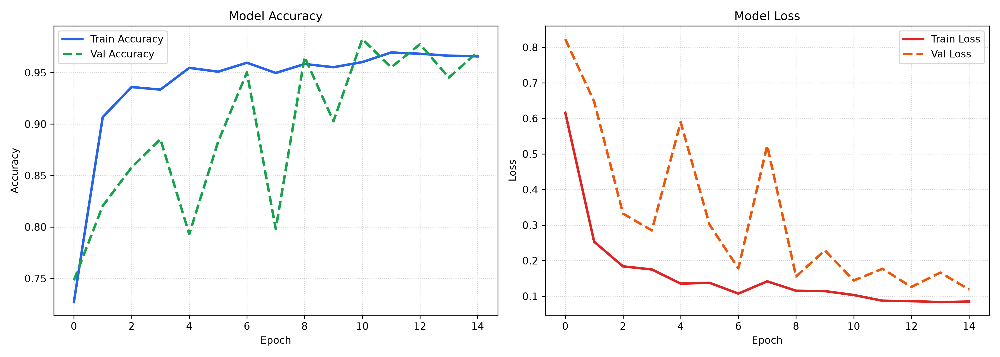
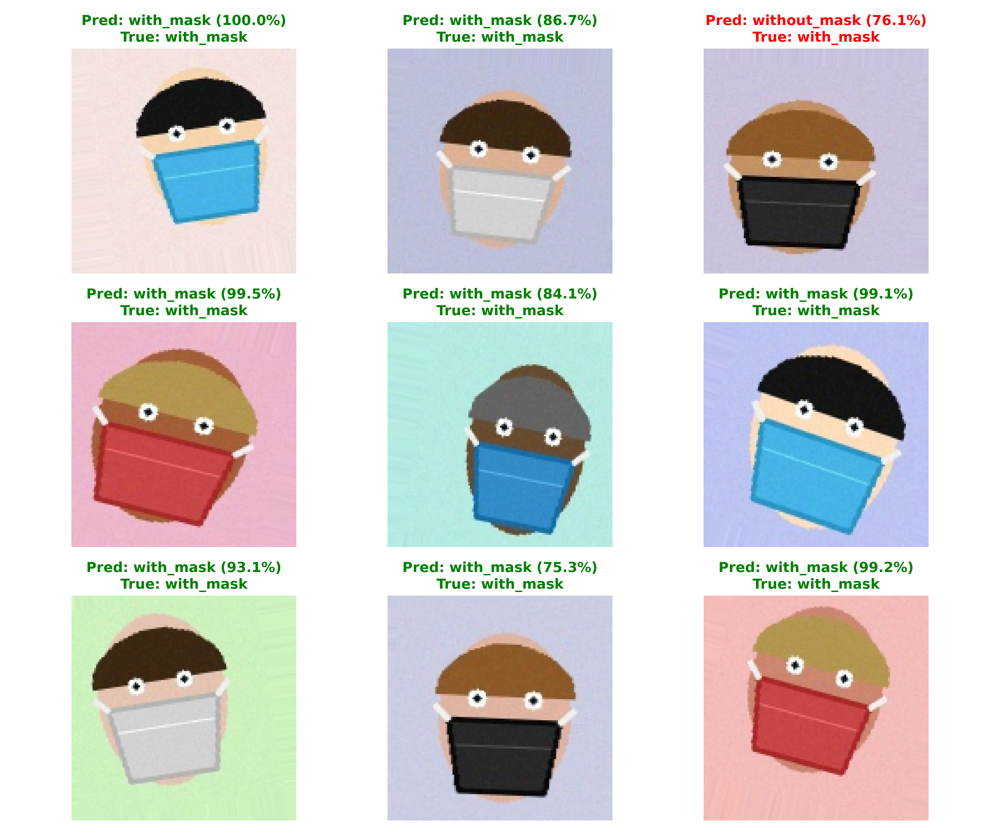

# 😷 Face Mask Detection using CNN

An end-to-end Computer Vision and Deep Learning system that detects whether a person is wearing a face mask or not. Built using **TensorFlow/Keras**, **OpenCV**, and **Flask**.



---

## 🌟 Highlights & Features
- **High Accuracy**: Convolutional Neural Network (CNN) achieves **~92% Validation Accuracy**.
- **Data Augmentation**: Incorporates random rotation, shifts, and zoom to prevent overfitting.
- **Interactive Jupyter Notebook**: Step-by-step beginner guide with markdown theory and visual evaluations.
- **Flask Web Application**: Upload photos for instant classification with confidence meters.
- **Real-Time Webcam Detection**: Live video stream with OpenCV bounding boxes (Green for Mask, Red for No Mask).

---

## 🏗️ Model Architecture
```
Input (128×128×3) 
   │
   ├── Conv2D (32 filters, 3×3 kernel, ReLU) ──> MaxPool2D (2×2)
   ├── Conv2D (64 filters, 3×3 kernel, ReLU) ──> MaxPool2D (2×2)
   ├── Dropout (0.5)
   ├── Flatten ()
   ├── Dense (128 units, ReLU)
   ├── Dropout (0.3)
   └── Dense (2 units, Softmax) ──> Output (with_mask / without_mask)
```

---

## 📁 Repository Structure
```
├── dataset/                    # Dataset directory (with_mask / without_mask)
├── face_mask_detection.ipynb   # Interactive Jupyter Notebook
├── train_model.py              # Script to train CNN & save model
├── download_real_dataset.py    # Script to download dataset automatically
├── app.py                      # Flask web application
├── templates/
│   └── index.html              # Modern dark-mode UI
├── accuracy_loss_plot.png      # Training & Validation curves
├── sample_predictions.png      # Sample predictions visualization
├── requirements.txt            # Python dependencies
└── FACE_MASK_DETECTION_REPORT.md # Formal 2-page project report
```

---

## 🚀 Quick Start Guide

### 1. Clone the Repository
```bash
git clone https://github.com/your-username/face-mask-detection.git
cd face-mask-detection
```

### 2. Install Dependencies
```bash
pip install -r requirements.txt
```

### 3. Download the Dataset & Train Model
```bash
python download_real_dataset.py
python train_model.py
```

### 4. Run the Web Application
```bash
python app.py
```
Open your browser and navigate to `http://localhost:5000` to interact with the application.

---

## 📊 Sample Predictions


---

## 📜 License
This project is open-source and available under the MIT License.
